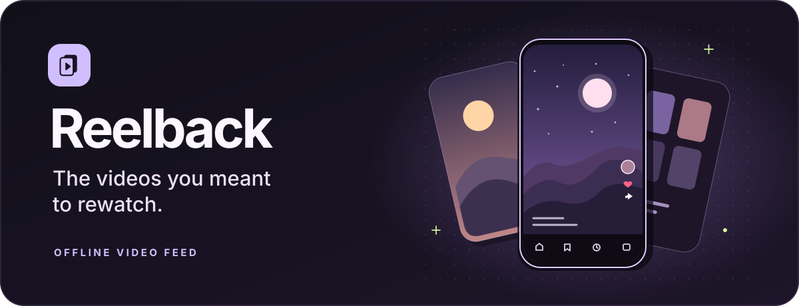
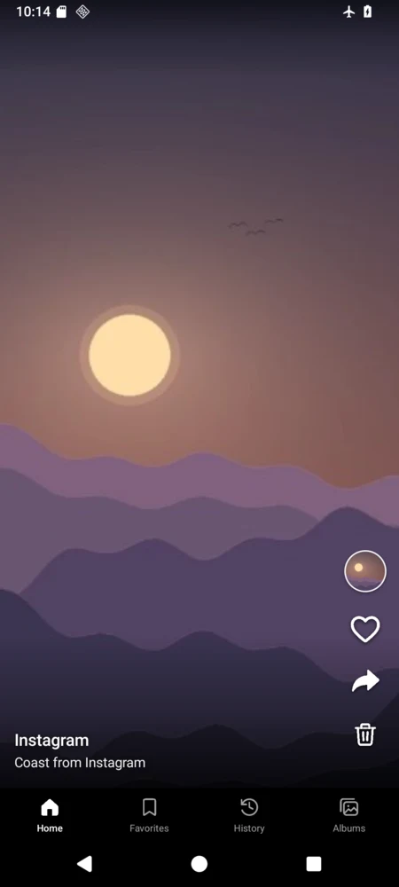
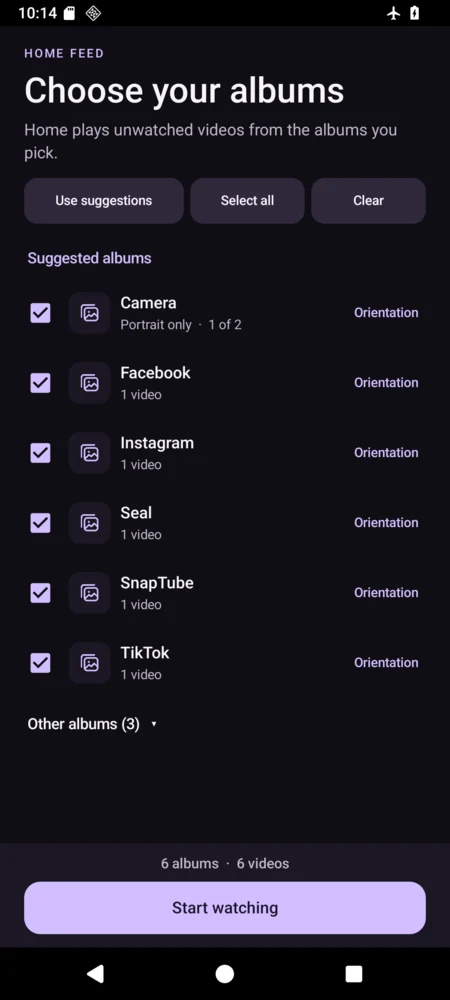
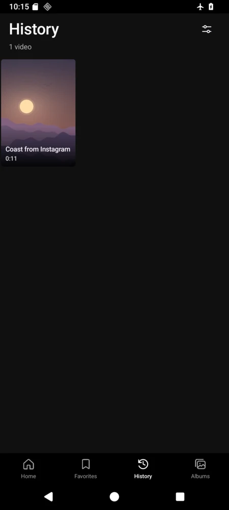

<div align="center">
  
</div>

<h1 align="center">Reelback for Android</h1>

<p align="center">Swipe through the videos already on your phone. Keep your favorites and pick which albums Home plays.</p>

<p align="center">
  <strong><a href="https://github.com/altarafiya/reelback/releases/latest/download/Reelback.apk">Download the APK</a></strong>
  · <a href="https://github.com/altarafiya/reelback/releases">Release notes</a>
  · Android 11+
</p>

<table>
  <tr>
    <td align="center" width="25%"><br><strong>Shuffle feed</strong><br>Rediscover unwatched clips.</td>
    <td align="center" width="25%"><br><strong>Local albums</strong><br>Choose folders and orientations.</td>
    <td align="center" width="25%"><br><strong>Watch history</strong><br>Replay or mark clips unwatched.</td>
    <td align="center" width="25%"><br><strong>Quick gestures</strong><br>Swipe, seek, and hold for 2×.</td>
  </tr>
</table>

<table>
  <tr>
    <td align="center"><br><strong>Home</strong></td>
    <td align="center"><br><strong>Feed setup</strong></td>
    <td align="center"><br><strong>History</strong></td>
  </tr>
</table>

The screenshots use demo clips.

## Get started

1. Download `Reelback.apk` from Releases and open it on an Android 11 or later device. Android may ask you to allow installation from the app that opened the APK.
2. Grant access to your videos and choose the albums you want in Home. Setup suggests portrait Camera clips and folders named for common download apps. You can change your choices in **Settings → Feed albums**.
3. Swipe up or down to browse. Tap to pause and reveal the seek bar. Double tap to save a favorite. Hold the middle for video options, or hold either side while playing for temporary 2× speed.

Landscape videos fit the full frame. Tap an album cover to open its folder, or use **Clear display** in the video options to watch with fewer controls. Share uses Android’s share sheet, and Trash asks for Android confirmation.

## New in 1.4

- **Mark as watched** sends a clip to History and advances Home.
- **Mark as unwatched** makes the clip eligible for Home again if its album and orientation are included.
- **Video details** shows the album, folder, duration, orientation, and frame size.

Reelback also adds a clip to History after 80% of the clip has played. Home keeps the current clip on screen until you leave it, then skips it on future visits.

## Privacy

Reelback reads videos Android has indexed in your gallery. It opens files in the background, uses one native media player, and caches nearby thumbnails for swiping. Favorites, album choices, and watch history stay on the device. The app has no account, analytics, or network permission.

## Build from source

Open this folder in Android Studio with JDK 17, Android SDK Platform 36, and Build Tools 36.0.0. The Gradle project uses Android Gradle Plugin 8.13.2.

To build a signed APK from the command line, set `JAVA_HOME`, `ANDROID_SDK_ROOT`, `REELBACK_KEYSTORE`, and `REELBACK_STORE_PASSWORD`, then run the build script.

```sh
./build-apk.sh
```

The APK is written to `build/Reelback.apk`. Pass a different output path as the first argument if needed. The script expects a key named `reelback` by default. Set `REELBACK_KEY_ALIAS` to use another alias.

This command creates a signing key for your own build.

```sh
keytool -genkeypair -keystore reelback.p12 -storetype PKCS12 -alias reelback \
  -keyalg RSA -keysize 3072 -validity 10000 -dname "CN=Reelback"
```

Android requires the same signing key to install an update over an existing installation.
